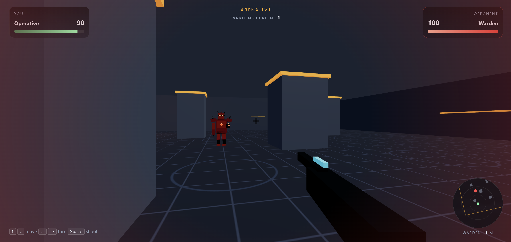

# Arena 1v1



A small first-person arena shooter that runs in the browser. You are dropped into a single room with one opponent, the **Warden**, and the first to run out of health loses. The pillars in the room block line of sight and bullets, so use them as cover.

Built with plain HTML, CSS and JavaScript, plus [Three.js](https://threejs.org/) for 3D rendering. There is no build step and nothing to install.

## Play it

1. Clone the repo:
   ```bash
   git clone https://github.com/tyronarnold/arena-game.git
   cd arena-game
   ```
2. Open `index.html` in a modern browser.

   Or serve the folder locally with Python from the project folder:
   ```bash
   python -m http.server 8765 --bind 127.0.0.1
   ```
   Then open http://127.0.0.1:8765 in your browser. Press <kbd>Ctrl</kbd>+<kbd>C</kbd> in the terminal to stop the server.

You need an internet connection, because Three.js is loaded from a CDN (unpkg).

## Controls

| Action | Key |
|---|---|
| Move forward / back | <kbd>↑</kbd> <kbd>↓</kbd> |
| Turn left / right | <kbd>←</kbd> <kbd>→</kbd> |
| Shoot | <kbd>Space</kbd> |
| Start / restart | <kbd>Enter</kbd> or <kbd>Space</kbd> on the menu, <kbd>R</kbd> after a match |

## Features

- **An opponent that reacts to you.** When the Warden can see you, it keeps its distance, strafes side to side and fires at you. Its chest core and cannon glow brighter as it charges a shot. When it loses sight of you, it patrols the corners of the arena.
- **HUD:**
  - health bars and numbers for both fighters
  - a radar centred on you, showing the pillars, the Warden and bullets in flight
  - an arrow pointing to the Warden when it's off-screen
  - an "Incoming" warning while the Warden charges a shot
  - a count of how many times you've won
- **Health regeneration.** After a few seconds without being hit, you heal over time.
- **Saved win count.** Your wins are kept in the browser's `localStorage`, so they survive page reloads.
- **No image or sound files.** The floor texture is drawn in code, the models are built from simple shapes, and the sound effects are generated with the Web Audio API.

## Project structure

```
index.html   Page layout: the HUD and the start / game-over menu
styles.css   Styling for the HUD, health bars, radar, crosshair and menu
game.js      Builds the 3D scene, reads input, runs the Warden, moves bullets,
             handles collisions, updates the HUD and runs the game loop
```

`game.js` creates a full-screen WebGL canvas behind the HUD. Every frame, the game loop:
- reads keyboard input;
- moves you, the Warden and any bullets;
- checks for hits;
- updates the HUD elements;
- renders the scene.

## Tuning the difficulty

All the difficulty settings are in the `TUNE` object at the top of `game.js`:

```js
const TUNE = {
  playerDamage: 34,      // damage per hit on the Warden (3 hits to win)
  enemyHitRadius: 0.8,   // how forgiving your shots are
  enemyDamage: 10,       // damage per Warden hit on you
  enemyCooldown: 1.7,    // seconds between Warden shots
  enemyWindup: 0.7,      // warning time before each Warden shot
  enemySpread: 0.3,      // Warden aim inaccuracy
  enemyBulletSpeed: 16,  // slower shots are easier to dodge
  enemySpeed: 4.4,       // Warden move speed
  playerHitRadius: 0.4,  // how close Warden shots must land to hit you
  regenDelay: 3,         // seconds without damage before you heal
  regenRate: 12          // HP per second while healing
};
```

To make the game harder, lower `enemyCooldown`, `enemyWindup` or `enemySpread`, or raise `enemyDamage` or `regenDelay`.

To reset your saved win count, run this in the browser's developer console, then reload the page:

```js
localStorage.removeItem("arena.wins")
```
